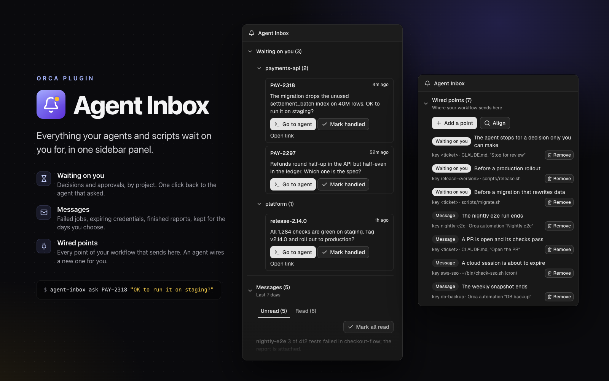

# Agent Inbox



An [Orca](https://onorca.dev) plugin that shows, in one sidebar panel, what your agents and scripts wait on
you for:

- **Waiting on you**: workspaces an agent parked in a board column because it needs your decision, approval
  or help, with the reason, grouped by project (the project with the newest ask first). **Go to agent**
  switches to the terminal that asked; **Mark handled** moves the workspace back.
- **Messages**: what happened that you should know (a long job failed, a report was posted, a credential
  expired), kept for as many days as you choose, under two tabs. **Unread** gives each one **Mark read**
  and has **Mark all read**; **Read** keeps them until they age out. Each tab shows the newest 20; **Show
  more** adds 20 at a time.
- **Wired points**: which points of your workflow write here, each with where it shows (Waiting on you or
  Messages), when it sends, its key and the file, script or automation that sends. Closed until you open it,
  then open or closed as you leave it.
  **Add a point** and each point's **Remove** start your default agent in the workspace selected in Orca,
  with a prompt to wire or unwire that point; the agent shows you the change, makes it once you agree, and
  updates the list with `agent-inbox point add` or `point remove`. **Align** starts the agent to compare the
  list with the `agent-inbox` calls in your workflow, after you changed the workflow by hand: it shows the
  differences and the commands that fix the list, and runs them once you agree. It changes only the list,
  never your workflow, and names problems it sees in the calls for you to fix.

At the bottom, **Star on GitHub** stars this repository with your GitHub account through your `gh` CLI; when
`gh` is missing or signed out it says so and links to the page instead.

Agents and scripts send with one CLI, `agent-inbox`, at the points of your workflow that need you. The plugin
ships a guide written for agents (`guide/agent-guide.md`): your agent goes through your workflow, Orca
automations included, finds those points and proposes how to wire each one.

## Install

[Open in Orca](https://onorca.dev/plugins/felix-lj-ct.agent-inbox?catalog=community), or from Orca: Settings →
Plugins, find **Agent Inbox** in the community catalog, or add this repository's Git URL. Enable it and approve
its access (see [What it can do](#what-it-can-do)).

When it starts, the plugin installs into `~/.config/agent-inbox/`:

| File | What it is |
| --- | --- |
| `bin/agent-inbox` | The CLI agents and scripts call |
| `config.env` | The plugin settings the CLI reads; rewritten on every settings change |
| `agent-guide.md` | The guide for agents |

The plugin rewrites these files whenever it starts and whenever you change its settings, so do not edit them.

On a first install (no log yet) **Waiting on you** starts with a **Set up Agent Inbox** task: the prompt from
[Wire your workflow](#wire-your-workflow), with **Copy prompt** and **Mark handled**. Once handled it does not
come back; the **Log file** setting in Settings → Plugins → Agent Inbox describes the same setup.

## Send

```sh
agent-inbox notify <key> "<message>" [<url>]                 # a line under Messages
agent-inbox ask [--worktree <path>] <key> "<message>" [<url>] # the workspace waits on you
agent-inbox resolve [--worktree <path>] <key>                 # it no longer does
agent-inbox test                                              # drill; undo with: agent-inbox resolve TEST
agent-inbox point add <id> <ask|notify> <key> "<when>" "<wired in>"  # a row under Wired points
agent-inbox point remove <id>                                 # the point no longer sends
agent-inbox point list                                        # the recorded points
agent-inbox where                                             # the settings in use
```

`<key>` names the work: a ticket id, a job name. `ask` moves the workspace of the current directory (or
`--worktree`) to the waiting column, with `<key>: <message>` as its comment and the unread dot, and records the
terminal it ran in, so **Go to agent** lands on the agent that asked. `resolve` moves the workspace back to the
resolved column only if it is still waiting, so a workspace you have moved on stays where you put it.

`point add` records a point of your workflow that sends, so the panel can list it: `<id>` names the point
(letters, digits, `.`, `_`, `-`; the same id again replaces it), `<key>` is the key it sends (a placeholder
such as `<ticket>` when it varies), then when it sends and where it is wired. The agent guide gives the
`point add` command for each point it proposes; you or your agent run it once the point is wired.

Exit codes: 0 done, 2 usage, 3 the orca CLI is missing or Orca is not running, 4 the log stayed locked. In a
script, end the call with `|| true` so a failed message does not fail the job.

## Wire your workflow

Give your agent this prompt:

> Read ~/.config/agent-inbox/agent-guide.md, go through my workflow, and tell me where to send Agent Inbox messages and how to wire each one.

The agent reads your instruction files, scripts, Orca automations (their prechecks and prompts) and other
scheduled jobs, and proposes a short table of trigger points (decision gates, approvals before irreversible
actions, expired credentials, used-up retries, finished or failed long jobs, handoffs). Each row says the
command, the message, the exact change in the file, script or automation that owns the point, and the
`agent-inbox point add` command that lists it under **Wired points**. The agent changes nothing: apply the
rows you keep yourself, or ask your agent to.

Later, to wire a new workflow, give the same prompt with that workflow's name in place of "my workflow". The
agent finds what is already wired, keeps its keys and wrappers, and proposes only for the new workflow; it
also proposes `point remove` for recorded points that no longer send. The
**Log file** setting repeats this, so you can find the prompt again without the README.

The guide is also a Claude Code skill. To have Claude Code load it whenever you ask about wiring Agent Inbox:

```sh
mkdir -p ~/.claude/skills/agent-inbox
ln -sf ~/.config/agent-inbox/agent-guide.md ~/.claude/skills/agent-inbox/SKILL.md
```

## Settings

Orca → Settings → Plugins → Agent Inbox.

| Setting | Default | What it does |
| --- | --- | --- |
| Log file | `~/.local/state/agent-inbox/inbox.jsonl` | Where the CLI writes and the panel reads; the wired points sit beside it |
| Keep messages for (days) | 7 | Lines older than this are removed when Orca starts, every hour and when settings change. A request still waiting on you is kept however old it is |
| Waiting column | `in-review` | Board status id that `ask` moves the workspace to; the panel lists every workspace in it |
| Resolved column | `in-progress` | Board status id that `resolve` and Mark handled move it back to |
| Language | Same as Orca | English or Simplified Chinese |
| orca command | found automatically | Path to the orca CLI, if the plugin cannot find it |

## How it works

- **The board is the source of truth for what waits.** Dragging a card out of the waiting column by hand is as
  good as Mark handled; a card you drag in shows up with its comment. A workspace has one waiting state: a
  later `ask` replaces the reason, one `resolve` clears it.
- **The log** is JSON Lines, one object per line: `v`, `ts` (UTC ISO 8601), `kind` (`notify`, `ask` or
  `resolve`), `key`, `message`, `url`, `worktree`, `terminal`. Tools may read it; write it only through the CLI.
- **Cleanup.** The worker prunes the log under a lock folder (`<log>.lock`) that the CLI also takes to append,
  so no line is lost while it rewrites the file. A lock left by a killed process is broken after a few seconds.
- **The points** sit beside the log (`inbox.jsonl` keeps them in `inbox.points.jsonl`), one JSON object per
  line: `v`, `id`, `kind`, `key`, `when`, `wiredIn`, `ts`. They do not age out; only the CLI writes them.
- **The orca CLI** reads and moves the board, because the plugin host API has no board methods yet.

## What it can do

The plugin runs as a `trusted-worker`: a Node.js process with your user's access. It uses that to:

- run the `orca` CLI to read the board and terminals, switch terminals, move workspaces between columns and,
  when you press **Add a point**, **Align** or **Remove**, start an agent in the selected workspace;
- read which agent is your default in Orca, read-only, from the settings in Orca's profile state
  (`profile-state.db` through the `sqlite3` command, else the older `orca-data.json`), because Orca does not
  give plugins that setting; it starts `claude` when it cannot tell;
- write `~/.config/agent-inbox/` and the log file, remove log lines past the retention window, and read the
  points file beside the log;
- when you press **Star on GitHub**, run `gh api --method PUT /user/starred/felix-lj-ct/orca-agent-inbox`
  with your own `gh` sign-in.

It asks Orca only for `storage:own` (which messages are read, the setup task) and `settings:own` (its settings), and
contributes no commands or status bar items. Its only network request is that star, made when you press it.

The worker runs while the panel needs it and stops when idle. Each start installs `~/.config/agent-inbox/` from
the current settings and prunes the log, so a settings change reaches the CLI the next time the panel opens.

Requirements: Orca 1.4.248 or later; macOS or Linux (the CLI is a bash script).

## Develop

```sh
orca plugin test .       # unit tests, the CLI against a fake orca, the worker and the panel
orca plugin check .      # renders the panel with the real worker
orca plugin validate .
orca plugin dev load . --approve <fingerprint>   # Orca prints the fingerprint
```

There is no build step: Orca transpiles the TypeScript when it loads. `src/protocol.ts` types the panel and
worker contract; `src/log.ts`, `src/points.ts`, `src/config.ts` and `src/board.ts` are pure; `src/store.ts` owns
the files; `src/launch.ts` finds the agent and the workspace for Add a point, Align and Remove.

The listing cover and icon in `images/` are drawn from the panel itself: the `cover` and `cover-points`
scenarios in `src/panel.check.ts` feed it made-up data, and `images/cover.html` lays the shots out. The
commands to redraw both images are at the top of that file.

## License

MIT
